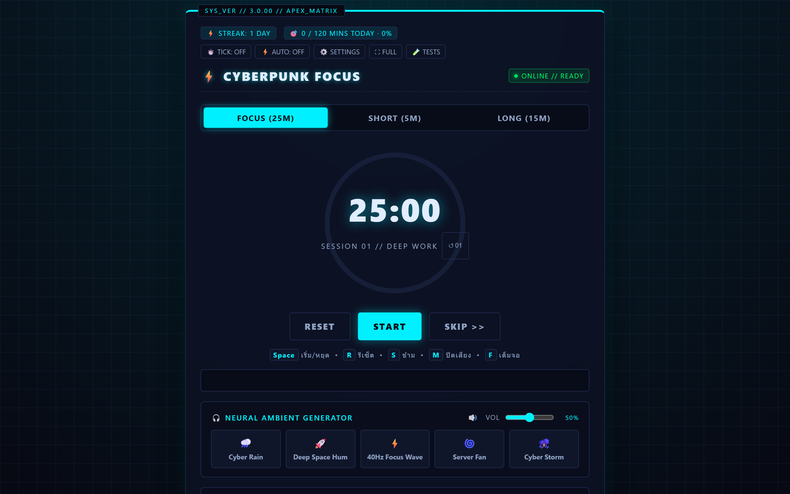

# ⚡ Cyberpunk Focus: Pomodoro Station

ตัวจับเวลา Pomodoro ธีม Cyberpunk พร้อมเครื่องสังเคราะห์เสียงบรรยากาศในตัว ทำงานในเบราว์เซอร์ ไม่ต้อง build และไม่มี dependency ภายนอก

[เดโมออนไลน์](https://okayokay101.github.io/cyberpunk-pomodoro/) · [หน้าทดสอบ](https://okayokay101.github.io/cyberpunk-pomodoro/test.html)



[English](README.md) · **ภาษาไทย**

## ฟีเจอร์

### ตัวจับเวลา
- **ตัวจับเวลา Pomodoro:** มีช่วงโฟกัส พักสั้น และพักยาว เข้าสู่ช่วงพักยาวอัตโนมัติหลังโฟกัสครบตามจำนวนรอบที่ตั้งไว้

### เสียง
- **เสียงบรรยากาศ:** เครื่องสังเคราะห์เสียง 5 รูปแบบผ่าน Web Audio API (Cyber Rain, Deep Space Hum, 40Hz Focus Wave, Server Fan, Cyber Storm) ไม่มีการดาวน์โหลดไฟล์เสียง
- **ภาพคลื่นเสียง:** วาดสเปกตรัมเสียงแบบเรียลไทม์บน canvas

### การติดตามและภารกิจ
- **ติดตามการโฟกัสรายวัน:** ระบบนับ Streak ต่อเนื่อง และบันทึกเวลาโฟกัสของวันนี้เป็นนาที
- **รายการภารกิจ:** ระบบจัดการภารกิจ เพิ่มงาน ติ๊กสถานะเมื่อสำเร็จ และรองรับการแยกหลายบอร์ด
- **ส่งออกและนำเข้าข้อมูล:** EXPORT DATA บันทึกไฟล์สำรอง (`cyberpunk-pomodoro-backup.json`) และ IMPORT DATA กู้คืนจากไฟล์สำรอง

### ลุค
- **ธีมนีออน 4 แบบ:** Cyan Matrix, Neon Pink, Night City Yellow, Emerald Hacker

## ความต้องการของระบบ
- เบราว์เซอร์รุ่นใหม่ที่รองรับ Web Audio และ `localStorage`
- สำหรับการทดสอบเท่านั้น: Node.js 20 และ Python 3.12 (เวอร์ชันเดียวกับใน [`.github/workflows/ci.yml`](.github/workflows/ci.yml))

## การติดตั้ง
```bash
git clone https://github.com/OkayOkay101/cyberpunk-pomodoro.git
cd cyberpunk-pomodoro
python -m http.server 8000
```
แล้วเปิด http://localhost:8000 ในเบราว์เซอร์ ไม่ต้องติดตั้งอะไรเพิ่ม การเปิดไฟล์ `index.html` ตรง ๆ จากดิสก์ อาจทำให้แคชออฟไลน์ (Service Worker) ใช้งานไม่ได้

## วิธีใช้งาน
| ปุ่ม | การทำงาน |
|---|---|
| <kbd>Space</kbd> | เริ่มหรือหยุดตัวจับเวลา |
| <kbd>R</kbd> | รีเซ็ตตัวจับเวลา |
| <kbd>S</kbd> | ข้ามไปรอบถัดไป |
| <kbd>M</kbd> | เปิดหรือปิดเสียง |
| <kbd>F</kbd> | สลับโหมดเต็มจอ |

## การตั้งค่า
ตั้งระยะเวลาโฟกัส พักสั้น พักยาว และเป้าหมายรายวันได้ในแผง Settings ค่าทั้งหมดและคำศัพท์อยู่ในหน้า [การตั้งค่าและคำศัพท์](docs/configuration_TH.md) ข้อมูลทั้งหมดเก็บอยู่ในเบราว์เซอร์ของคุณ

## การทดสอบ
```bash
node test-runner.js
python -m venv .venv    # สร้างแล้วเปิดใช้งานก่อน
python -m pip install -r requirements-dev.txt
python -m playwright install --with-deps chromium
python -m unittest discover -s tests -p "test_*.py"
python scripts/check_python_syntax.py
```
หน้าแดชบอร์ดทดสอบในเบราว์เซอร์คือ [`test.html`](test.html)

## โครงสร้างโปรเจกต์
- `index.html`: แอปหลัก (markup, style และ logic ของ UI)
- `core.js`: logic ที่ใช้ร่วมกันสำหรับเวลา ปุ่มลัด streak และป้ายกำกับ
- `netrunner_leveling.js`: logic ของ EXP และ rank (มีเทสต์ แต่ `index.html` ไม่ได้โหลดไฟล์นี้)
- `service-worker.js`, `manifest.webmanifest`: แคชส่วนหลักของแอปเพื่อใช้แบบออฟไลน์ และรองรับการติดตั้ง
- `test-runner.js`, `test.html`: เทสต์ยูนิตของ Node และในเบราว์เซอร์
- `tests/`: เทสต์ Python (unittest และ Playwright)
- `scripts/`: สคริปต์ตรวจสอบของรีโป
